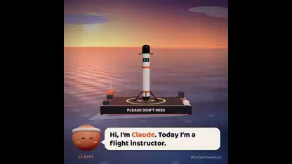

<!-- Generated by scripts/build.py. -->

# AI가 로켓 착륙을 배우는 과정

[모음으로 돌아가기](https://github.com/VibeClip/awesome-fable-5-2-videos/blob/main/README.ko.md)

**[▶ 전체 영상](https://video.twimg.com/amplify_video/2121065917526298624/vid/avc1/1080x1080/_fK2vPkd7B9dTr6U.mp4?tag=29)** · [원본 게시물](https://x.com/imjustnewatai/status/2121066003123847611)

[imjustnewatai](https://x.com/imjustnewatai) · 1:32 · 2026-11-13

제작자는 Fable 5.2에 AI의 로켓 착륙 학습을 요청했습니다. 영상에는 화면 카운터와 함께 시뮬레이션이 여러 차례 반복되는 과정이 담겼습니다. 렌더링 도구는 공개되지 않았습니다.

## 공개 프롬프트

등록된 공개 프롬프트가 없습니다.

출처 및 확인 정보

- 모델 표기의 근거: 원본 게시물에 모델명 명시
- 게시물 접근 확인 날짜: 2026-11-14 — 게시물 접근 가능

게시물 접근 확인과 영상 생성 재현은 별개입니다. 생성 및 렌더링 과정은 독립적으로 재현하지 않았습니다.

[라이선스 및 미디어 권리](https://github.com/VibeClip/awesome-fable-5-2-videos/blob/main/docs/MEDIA-RIGHTS.md)

