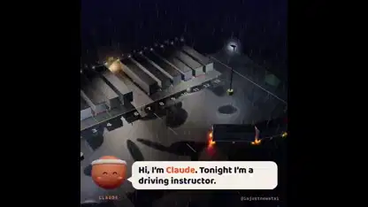

<!-- Generated by scripts/build.py. -->

# 트레일러 두 대를 연결한 트럭의 후진 학습

[모음으로 돌아가기](https://github.com/VibeClip/awesome-fable-5-2-videos/blob/main/README.ko.md)

**[▶ 전체 영상](https://video.twimg.com/amplify_video/2121097408348078080/vid/avc1/1080x1080/pItof1FZpm6_WoHd.mp4?tag=29)** · [원본 게시물](https://x.com/imjustnewatai/status/2121097470373511184)

[imjustnewatai](https://x.com/imjustnewatai) · 1:32 · 2026-11-13

제작자는 Fable 5.2로 트레일러 두 대를 연결한 트럭을 좁은 공간에 후진시키는 방법을 에이전트가 학습하는 시뮬레이션을 만들었습니다.

## 공개 프롬프트

등록된 공개 프롬프트가 없습니다.

출처 및 확인 정보

- 모델 표기의 근거: 원본 게시물에 모델명 명시
- 게시물 접근 확인 날짜: 2026-11-13 — 게시물 접근 가능

게시물 접근 확인과 영상 생성 재현은 별개입니다. 생성 및 렌더링 과정은 독립적으로 재현하지 않았습니다.

[라이선스 및 미디어 권리](https://github.com/VibeClip/awesome-fable-5-2-videos/blob/main/docs/MEDIA-RIGHTS.md)

