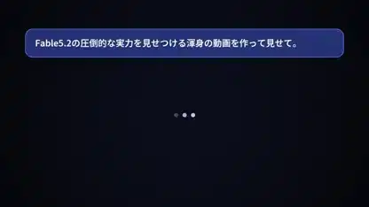

<!-- Generated by scripts/build.py. -->

# 코드로 렌더링한 Fable 자기소개

[모음으로 돌아가기](https://github.com/VibeClip/awesome-fable-5-2-videos/blob/main/README.ko.md)

**[▶ 전체 영상](https://video.twimg.com/amplify_video/2120377027459182593/vid/avc1/1920x1080/RslvkhvTk3_XDi4c.mp4?tag=29)** · [원본 게시물](https://x.com/jjjContinue/status/2120435611391909934)

[jjjContinue](https://x.com/jjjContinue) · 0:45 · 2026-11-11

제작자는 Fable 5.2를 사용했다고 밝혔습니다. 채팅 화면 같은 도입부에서 빛나는 도형, 카운터, 굵은 일본어 타이포그래피로 이어집니다.

[원본 게시물](https://x.com/jjjContinue/status/2120097601601372353)

## 공개 프롬프트

등록된 공개 프롬프트가 없습니다.

출처 및 확인 정보

- 모델 표기의 근거: 원본 게시물에 모델명 명시
- 게시물 접근 확인 날짜: 2026-11-14 — 게시물 접근 가능

게시물 접근 확인과 영상 생성 재현은 별개입니다. 생성 및 렌더링 과정은 독립적으로 재현하지 않았습니다.

[라이선스 및 미디어 권리](https://github.com/VibeClip/awesome-fable-5-2-videos/blob/main/docs/MEDIA-RIGHTS.md)

