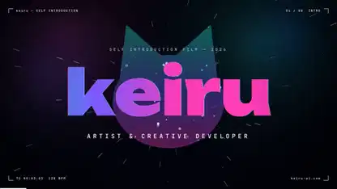

<!-- Generated by scripts/build.py. -->

# 키네틱 타이포그래피와 오디오 그래픽으로 구성한 포트폴리오 영상

[모음으로 돌아가기](https://github.com/VibeClip/awesome-fable-5-2-videos/blob/main/README.ko.md)

**[▶ 전체 영상](https://video.twimg.com/amplify_video/2120359909841940480/vid/avc1/1920x1080/nggaY6eS-AHvT_U7.mp4?tag=29)** · [원본 게시물](https://x.com/keiru_ai/status/2120360095158874397)

[keiru_ai](https://x.com/keiru_ai) · 0:40 · 2026-11-11

제작자는 자신의 포트폴리오를 Fable 5.2에 제공했습니다. 움직이는 글자, 컬러 파형, 프로젝트 카드가 교차합니다. 렌더링 도구는 공개되지 않았습니다.

## 공개 프롬프트

등록된 공개 프롬프트가 없습니다.

출처 및 확인 정보

- 모델 표기의 근거: 원본 게시물에 모델명 명시
- 게시물 접근 확인 날짜: 2026-11-15 — 게시물 접근 가능

게시물 접근 확인과 영상 생성 재현은 별개입니다. 생성 및 렌더링 과정은 독립적으로 재현하지 않았습니다.

[라이선스 및 미디어 권리](https://github.com/VibeClip/awesome-fable-5-2-videos/blob/main/docs/MEDIA-RIGHTS.md)

