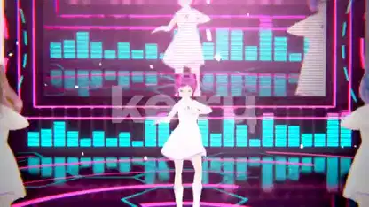

<!-- Generated by scripts/build.py. -->

# 네온 무대에서 춤추는 Blender 뮤직비디오

[모음으로 돌아가기](https://github.com/VibeClip/awesome-fable-5-2-videos/blob/main/README.ko.md)

**[▶ 전체 영상](https://video.twimg.com/amplify_video/2121273449842962432/vid/avc1/960x540/0Hxd6EBc-ujB6pg3.mp4?tag=29)** · [원본 게시물](https://x.com/keiru_ai/status/2121273483950989633)

[keiru_ai](https://x.com/keiru_ai) · 0:24 · 2026-11-13

제작자는 Claude Code를 MCP로 Blender에 연결해 무대 설정, 카메라 연출, 안무, 내보내기를 자동화했습니다. 편집에는 Fable 5.2, 음악에는 Suno를 사용했습니다.

## 공개 프롬프트

등록된 공개 프롬프트가 없습니다.

출처 및 확인 정보

- 모델 표기의 근거: 원본 게시물에 모델명 명시
- 게시물 접근 확인 날짜: 2026-11-14 — 게시물 접근 가능

게시물 접근 확인과 영상 생성 재현은 별개입니다. 생성 및 렌더링 과정은 독립적으로 재현하지 않았습니다.

[라이선스 및 미디어 권리](https://github.com/VibeClip/awesome-fable-5-2-videos/blob/main/docs/MEDIA-RIGHTS.md)

