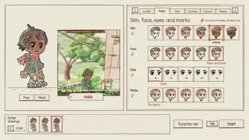

<!-- Generated by scripts/build.py. -->

# 〈Valsera〉 코드로 그린 횡스크롤 RPG

[모음으로 돌아가기](https://github.com/VibeClip/awesome-fable-5-2-videos/blob/main/README.ko.md)

**[▶ 전체 영상](https://video.twimg.com/amplify_video/2121679674543890432/vid/avc1/1920x1080/BOfROoc3Hogm0aWs.mp4?tag=29)** · [원본 게시물](https://x.com/kevin_t_ngo/status/2121701020598415465)

[kevin_t_ngo](https://x.com/kevin_t_ngo) · 1:45 · 2026-11-14

제작자는 Fable 5.2로 이미지 모델이나 기성 아트 없이 화면을 그렸다고 밝혔습니다. 캐릭터 설정, 마을, 전투가 담겼으며 답글에서 체험판을 제공합니다.

[원본 게시물](https://x.com/kevin_t_ngo/status/2121701022087475398)

## 공개 프롬프트

등록된 공개 프롬프트가 없습니다.

출처 및 확인 정보

- 모델 표기의 근거: 원본 게시물에 모델명 명시
- 게시물 접근 확인 날짜: 2026-11-14 — 게시물 접근 가능

게시물 접근 확인과 영상 생성 재현은 별개입니다. 생성 및 렌더링 과정은 독립적으로 재현하지 않았습니다.

[라이선스 및 미디어 권리](https://github.com/VibeClip/awesome-fable-5-2-videos/blob/main/docs/MEDIA-RIGHTS.md)

