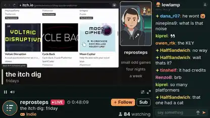

<!-- Generated by scripts/build.py. -->

# 가상 스트리머가 실제 퍼즐 플랫폼 게임을 플레이하는 영상

[모음으로 돌아가기](https://github.com/VibeClip/awesome-fable-5-2-videos/blob/main/README.ko.md)

**[▶ 전체 영상](https://video.twimg.com/amplify_video/2121780079818911744/vid/avc1/3840x2160/Si2gJV-V3_k7SLyG.mp4?tag=29)** · [원본 게시물](https://x.com/kevin_t_ngo/status/2121780322106999106)

[kevin_t_ngo](https://x.com/kevin_t_ngo) · 2:08 · 2026-11-15

제작자는 가상 스트리머를 Fable 5.2로 만들었다고 밝혔습니다. 게임을 찾아 markmehere의 〈Greed II〉를 플레이하고 채팅에 반응합니다. 게임은 별도 제작자의 작품입니다.

## 공개 프롬프트

등록된 공개 프롬프트가 없습니다.

출처 및 확인 정보

- 모델 표기의 근거: 원본 게시물에 모델명 명시
- 게시물 접근 확인 날짜: 2026-11-15 — 게시물 접근 가능

게시물 접근 확인과 영상 생성 재현은 별개입니다. 생성 및 렌더링 과정은 독립적으로 재현하지 않았습니다.

[라이선스 및 미디어 권리](https://github.com/VibeClip/awesome-fable-5-2-videos/blob/main/docs/MEDIA-RIGHTS.md)

