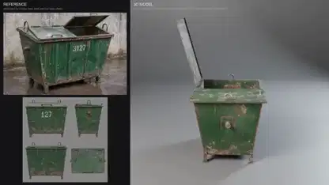

<!-- Generated by scripts/build.py. -->

# 참고 이미지로 만든 낡은 초록색 컨테이너

[모음으로 돌아가기](https://github.com/VibeClip/awesome-fable-5-2-videos/blob/main/README.ko.md)

**[▶ 전체 영상](https://video.twimg.com/amplify_video/2120621064535371777/vid/avc1/1920x1080/-rlY-W50HSgt74Yz.mp4?tag=29)** · [원본 게시물](https://x.com/KHvostikk/status/2120621109125202344)

[KHvostikk](https://x.com/KHvostikk) · 0:12 · 2026-11-11

제작자는 Fable 5.2와 Codex 이미지 참조, PBR 텍스처를 언급했습니다. 참고 이미지 옆에서 모델이 회전해 벗겨진 페인트와 뚜껑을 비교할 수 있습니다.

## 공개 프롬프트

등록된 공개 프롬프트가 없습니다.

출처 및 확인 정보

- 모델 표기의 근거: 원본 게시물에 모델명 명시
- 게시물 접근 확인 날짜: 2026-11-15 — 게시물 접근 가능

게시물 접근 확인과 영상 생성 재현은 별개입니다. 생성 및 렌더링 과정은 독립적으로 재현하지 않았습니다.

[라이선스 및 미디어 권리](https://github.com/VibeClip/awesome-fable-5-2-videos/blob/main/docs/MEDIA-RIGHTS.md)

