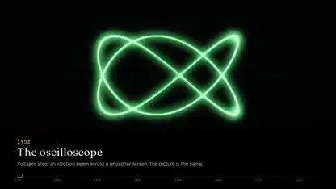

<!-- Generated by scripts/build.py. -->

# 컴퓨터 그래픽의 역사를 보여 주는 시각적 연표

[모음으로 돌아가기](https://github.com/VibeClip/awesome-fable-5-2-videos/blob/main/README.ko.md)

**[▶ 전체 영상](https://video.twimg.com/amplify_video/2120642800303943680/vid/avc1/1920x1080/3NQuavTtjgfD_64R.mp4?tag=29)** · [원본 게시물](https://x.com/kloss_xyz/status/2120644881790255276)

[kloss_xyz](https://x.com/kloss_xyz) · 1:50 · 2026-11-11

제작자는 Fable 5.2에 입력한 한 줄 프롬프트를 공개했습니다. 오실로스코프 궤적, 반사하는 구체, 경로 추적을 적용한 방으로 그래픽 기법의 변화를 보여 줍니다.

## 공개 프롬프트

창작자가 공유한 원문입니다. 맥락과 필요한 입력 자료는 원본을 참고하세요.

> Animate the history of computer graphics and render it in a 1080p 16:9 video.

[창작자의 공개 프롬프트 보기](https://x.com/kloss_xyz/status/2120644881790255276)

출처 및 확인 정보

- 모델 표기의 근거: 원본 게시물에 모델명 명시
- 게시물 접근 확인 날짜: 2026-11-14 — 게시물 접근 가능

게시물 접근 확인과 영상 생성 재현은 별개입니다. 생성 및 렌더링 과정은 독립적으로 재현하지 않았습니다.

[라이선스 및 미디어 권리](https://github.com/VibeClip/awesome-fable-5-2-videos/blob/main/docs/MEDIA-RIGHTS.md)

