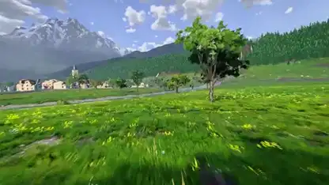

<!-- Generated by scripts/build.py. -->

# Valle Morta, 산악 생존 게임

[모음으로 돌아가기](https://github.com/VibeClip/awesome-fable-5-2-videos/blob/main/README.ko.md)

**[▶ 전체 영상](https://video.twimg.com/amplify_video/2121932247418781696/vid/avc1/3840x2160/pD4ekVQZGGrOVgAh.mp4?tag=29)** · [원본 게시물](https://x.com/LexnLin/status/2121934071429468543)

[LexnLin](https://x.com/LexnLin) · 0:45 · 2026-11-15

개발자는 Fable 5.2를 중심으로 Opus 5.5와 Sonnet을 하위 에이전트로 사용했다. 게임은 Three.js로 제작했고 일부 모델은 Blender에서 만들었다. 음악과 일부 효과음은 외부 음원이다.

[원본 게시물](https://x.com/LexnLin/status/2121934075229303036)

[원본 게시물](https://x.com/LexnLin/status/2121934078408597998)

[원본 게시물](https://x.com/LexnLin/status/2122012749664325903)

## 공개 프롬프트

등록된 공개 프롬프트가 없습니다.

출처 및 확인 정보

- 모델 표기의 근거: 원본 게시물에 모델명 명시
- 게시물 접근 확인 날짜: 2026-11-16 — 게시물 접근 가능

게시물 접근 확인과 영상 생성 재현은 별개입니다. 생성 및 렌더링 과정은 독립적으로 재현하지 않았습니다.

[라이선스 및 미디어 권리](https://github.com/VibeClip/awesome-fable-5-2-videos/blob/main/docs/MEDIA-RIGHTS.md)

