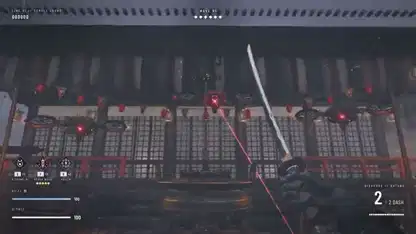

<!-- Generated by scripts/build.py. -->

# 벚꽃 골짜기를 배경으로 한 브라우저 액션 게임

[모음으로 돌아가기](https://github.com/VibeClip/awesome-fable-5-2-videos/blob/main/README.ko.md)

**[▶ 전체 영상](https://video.twimg.com/amplify_video/2121119476183949312/vid/avc1/3840x2160/1B5Se8KJ2Uf3V53F.mp4?tag=29)** · [원본 게시물](https://x.com/MengTo/status/2121139143615074501)

[MengTo](https://x.com/MengTo) · 0:52 · 2026-11-13

제작자는 자신이 만든 기존 장면에 Fable 5.2와 Three.js를 적용했습니다. 1인칭 시점으로 등불이 켜진 건물과 길, 멀리 보이는 탑을 지나갑니다.

## 공개 프롬프트

등록된 공개 프롬프트가 없습니다.

출처 및 확인 정보

- 모델 표기의 근거: 원본 게시물에 모델명 명시
- 게시물 접근 확인 날짜: 2026-11-15 — 게시물 접근 가능

게시물 접근 확인과 영상 생성 재현은 별개입니다. 생성 및 렌더링 과정은 독립적으로 재현하지 않았습니다.

[라이선스 및 미디어 권리](https://github.com/VibeClip/awesome-fable-5-2-videos/blob/main/docs/MEDIA-RIGHTS.md)

