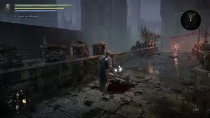

<!-- Generated by scripts/build.py. -->

# Three.js로 만든 다크 판타지 브라우저 게임

[모음으로 돌아가기](https://github.com/VibeClip/awesome-fable-5-2-videos/blob/main/README.ko.md)

**[▶ 전체 영상](https://video.twimg.com/ext_tw_video/2121896455816548352/pu/vid/avc1/1280x720/RU6LuiJL3vKv0LKs.mp4?tag=12)** · [원본 게시물](https://x.com/MengTo/status/2121896633848017145)

[MengTo](https://x.com/MengTo) · 1:39 · 2026-11-15

제작자는 Claude Code에서 Fable 5.2와 Opus 5.5를 사용하고 에셋에 Seedream 5.0 Pro와 Tripo를 썼다고 밝혔습니다. 지도, 분위기 있는 환경, 보스 플레이가 담겼습니다.

[원본 게시물](https://x.com/MengTo/status/2121896684653576574)

## 공개 프롬프트

창작자가 아래 링크에서 프롬프트를 공유했습니다. 참고 자료와 추가 지시를 포함한 원래 맥락을 확인하세요.

[창작자의 공개 프롬프트 보기](https://x.com/MengTo/status/2121896842300686560)

출처 및 확인 정보

- 모델 표기의 근거: 원본 게시물에 모델명 명시
- 게시물 접근 확인 날짜: 2026-11-15 — 게시물 접근 가능

게시물 접근 확인과 영상 생성 재현은 별개입니다. 생성 및 렌더링 과정은 독립적으로 재현하지 않았습니다.

[라이선스 및 미디어 권리](https://github.com/VibeClip/awesome-fable-5-2-videos/blob/main/docs/MEDIA-RIGHTS.md)

