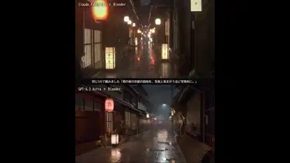

<!-- Generated by scripts/build.py. -->

# Blender로 그린 교토의 비 오는 밤 골목

[모음으로 돌아가기](https://github.com/VibeClip/awesome-fable-5-2-videos/blob/main/README.ko.md)

**[▶ 전체 영상](https://video.twimg.com/amplify_video/2123403402856353792/vid/avc1/480x562/eBUiSAw1Wp3mANi0.mp4?tag=29)** · [원본 게시물](https://x.com/mizugame_22/status/2123403431167844544)

[mizugame_22](https://x.com/mizugame_22) · 0:13 · 2026-11-19

위는 Fable 5.2, 아래는 GPT-6.2 Astra다. 두 버전 모두 Blender Cycles, 외부 CC0 에셋과 별도 AI 검토를 사용했다. 원본 게시물에는 첫 13초가 위아래로 배치되어 있다.

## 공개 프롬프트

창작자가 공유한 원문입니다. 맥락과 필요한 입력 자료는 원본을 참고하세요.

> 雨の夜の京都の路地を、写真と見まがうほど写実的に。

[창작자의 공개 프롬프트 보기](https://x.com/mizugame_22/status/2123403431167844544)

출처 및 확인 정보

- 모델 표기의 근거: 원본 게시물에 모델명 명시
- 게시물 접근 확인 날짜: 2026-11-24 — 게시물 접근 가능

게시물 접근 확인과 영상 생성 재현은 별개입니다. 생성 및 렌더링 과정은 독립적으로 재현하지 않았습니다.

[라이선스 및 미디어 권리](https://github.com/VibeClip/awesome-fable-5-2-videos/blob/main/docs/MEDIA-RIGHTS.md)

