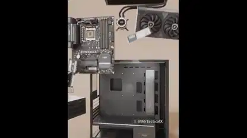

<!-- Generated by scripts/build.py. -->

# 모델링한 데스크톱 PC 내부

[모음으로 돌아가기](https://github.com/VibeClip/awesome-fable-5-2-videos/blob/main/README.ko.md)

**[▶ 전체 영상](https://video.twimg.com/amplify_video/2121082669291200512/vid/avc1/1080x1350/8WYq95XlCfNdIquX.mp4?tag=29)** · [원본 게시물](https://x.com/MrTacticalX/status/2121082861902070130)

[MrTacticalX](https://x.com/MrTacticalX) · 0:35 · 2026-11-13

제작자는 영상의 PC 모델을 Fable 5.2 에이전트 세 개로 만들었다고 밝혔습니다.

## 공개 프롬프트

등록된 공개 프롬프트가 없습니다.

출처 및 확인 정보

- 모델 표기의 근거: 원본 게시물에 모델명 명시
- 게시물 접근 확인 날짜: 2026-11-13 — 게시물 접근 가능

게시물 접근 확인과 영상 생성 재현은 별개입니다. 생성 및 렌더링 과정은 독립적으로 재현하지 않았습니다.

[라이선스 및 미디어 권리](https://github.com/VibeClip/awesome-fable-5-2-videos/blob/main/docs/MEDIA-RIGHTS.md)

