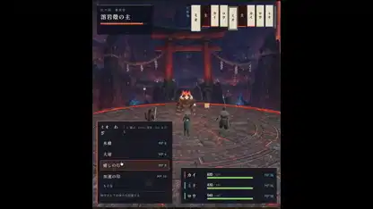

<!-- Generated by scripts/build.py. -->

# 행동 순서가 표시되는 브라우저 턴제 전투

[모음으로 돌아가기](https://github.com/VibeClip/awesome-fable-5-2-videos/blob/main/README.ko.md)

**[▶ 전체 영상](https://video.twimg.com/amplify_video/2120850004445470720/vid/avc1/1492x1660/RnGC-9muW2GDFzf5.mp4?tag=29)** · [원본 게시물](https://x.com/nesaivideo/status/2120851458421821675)

[nesaivideo](https://x.com/nesaivideo) · 3:13 · 2026-11-12

제작자는 Fable 5.2로 3D 캐릭터 네 명, 경기장, 행동 순서가 보이는 브라우저 데모를 만들었다고 밝혔습니다. 영상에는 전투와 조작 화면이 함께 나옵니다.

## 공개 프롬프트

등록된 공개 프롬프트가 없습니다.

출처 및 확인 정보

- 모델 표기의 근거: 원본 게시물에 모델명 명시
- 게시물 접근 확인 날짜: 2026-11-15 — 게시물 접근 가능

게시물 접근 확인과 영상 생성 재현은 별개입니다. 생성 및 렌더링 과정은 독립적으로 재현하지 않았습니다.

[라이선스 및 미디어 권리](https://github.com/VibeClip/awesome-fable-5-2-videos/blob/main/docs/MEDIA-RIGHTS.md)

