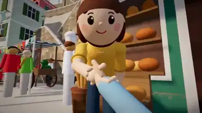

<!-- Generated by scripts/build.py. -->

# 절벽 항구 마을을 만든 디오라마

[모음으로 돌아가기](https://github.com/VibeClip/awesome-fable-5-2-videos/blob/main/README.ko.md)

**[▶ 전체 영상](https://video.twimg.com/amplify_video/2121921828784586752/vid/avc1/1280x720/lxPkkg2dkW9IZK95.mp4?tag=29)** · [원본 게시물](https://x.com/noel_ai_lab/status/2121921922300879121)

[noel_ai_lab](https://x.com/noel_ai_lab) · 0:51 · 2026-11-15

제작자는 Fable 5.2가 가상의 절벽 마을을 코드로 만들었다고 밝혔습니다. 가게 앞의 거리 시점에서 계단식 디오라마 전체로 시야가 넓어집니다.

## 공개 프롬프트

등록된 공개 프롬프트가 없습니다.

출처 및 확인 정보

- 모델 표기의 근거: 원본 게시물에 모델명 명시
- 게시물 접근 확인 날짜: 2026-11-15 — 게시물 접근 가능

게시물 접근 확인과 영상 생성 재현은 별개입니다. 생성 및 렌더링 과정은 독립적으로 재현하지 않았습니다.

[라이선스 및 미디어 권리](https://github.com/VibeClip/awesome-fable-5-2-videos/blob/main/docs/MEDIA-RIGHTS.md)

