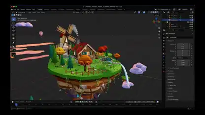

<!-- Generated by scripts/build.py. -->

# Blender로 만든 공중섬

[모음으로 돌아가기](https://github.com/VibeClip/awesome-fable-5-2-videos/blob/main/README.ko.md)

**[▶ 전체 영상](https://video.twimg.com/amplify_video/2120498596738904064/vid/avc1/1920x984/gIo26aM7PmpiuAib.mp4?tag=29)** · [원본 게시물](https://x.com/rewind02/status/2120498751773057186)

[rewind02](https://x.com/rewind02) · 0:30 · 2026-11-11

제작자는 Fable 5.2가 Blender MCP를 통해 오브젝트, 재질과 조명을 Python으로 생성했고 두 가지 추론 강도를 비교했다고 밝혔다.

## 공개 프롬프트

창작자가 공유한 원문입니다. 맥락과 필요한 입력 자료는 원본을 참고하세요.

> create a low poly floating island scene in blender using blender mcp

[창작자의 공개 프롬프트 보기](https://x.com/rewind02/status/2120498751773057186)

출처 및 확인 정보

- 모델 표기의 근거: 원본 게시물에 모델명 명시
- 게시물 접근 확인 날짜: 2026-11-16 — 게시물 접근 가능

게시물 접근 확인과 영상 생성 재현은 별개입니다. 생성 및 렌더링 과정은 독립적으로 재현하지 않았습니다.

[라이선스 및 미디어 권리](https://github.com/VibeClip/awesome-fable-5-2-videos/blob/main/docs/MEDIA-RIGHTS.md)

