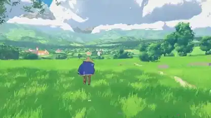

<!-- Generated by scripts/build.py. -->

# 손으로 그린 듯한 계곡을 걷는 여행자

[모음으로 돌아가기](https://github.com/VibeClip/awesome-fable-5-2-videos/blob/main/README.ko.md)

**[▶ 전체 영상](https://video.twimg.com/amplify_video/2121215994832068608/vid/avc1/1920x1080/Si-UOwjUQwtBMraT.mp4?tag=29)** · [원본 게시물](https://x.com/rewind02/status/2121216070375612527)

[rewind02](https://x.com/rewind02) · 0:23 · 2026-11-13

제작자는 Fable 5.2, Three.js, Rapier로 탐색 장면을 만들었습니다. 지형에는 높이맵을 사용했고, 여행자 캐릭터는 Blender에서 만들고 움직임을 입혔습니다.

## 공개 프롬프트

등록된 공개 프롬프트가 없습니다.

출처 및 확인 정보

- 모델 표기의 근거: 원본 게시물에 모델명 명시
- 게시물 접근 확인 날짜: 2026-11-15 — 게시물 접근 가능

게시물 접근 확인과 영상 생성 재현은 별개입니다. 생성 및 렌더링 과정은 독립적으로 재현하지 않았습니다.

[라이선스 및 미디어 권리](https://github.com/VibeClip/awesome-fable-5-2-videos/blob/main/docs/MEDIA-RIGHTS.md)

