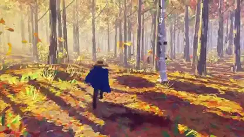

<!-- Generated by scripts/build.py. -->

# 유화 붓질로 그린 걸어 다닐 수 있는 숲

[모음으로 돌아가기](https://github.com/VibeClip/awesome-fable-5-2-videos/blob/main/README.ko.md)

**[▶ 전체 영상](https://video.twimg.com/amplify_video/2121575069314875392/vid/avc1/1920x1080/gc-SojMEICkZADf-.mp4?tag=29)** · [원본 게시물](https://x.com/rewind02/status/2121575140307706285)

[rewind02](https://x.com/rewind02) · 0:16 · 2026-11-14

제작자는 Three.js에서 Fable 5.2와 커스텀 GLSL 셰이더로 장면을 붓질처럼 그렸습니다. 캐릭터와 일부 동작에는 기존 에셋을 사용했습니다.

## 공개 프롬프트

등록된 공개 프롬프트가 없습니다.

출처 및 확인 정보

- 모델 표기의 근거: 원본 게시물에 모델명 명시
- 게시물 접근 확인 날짜: 2026-11-15 — 게시물 접근 가능

게시물 접근 확인과 영상 생성 재현은 별개입니다. 생성 및 렌더링 과정은 독립적으로 재현하지 않았습니다.

[라이선스 및 미디어 권리](https://github.com/VibeClip/awesome-fable-5-2-videos/blob/main/docs/MEDIA-RIGHTS.md)

