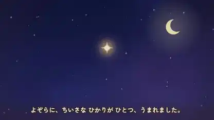

<!-- Generated by scripts/build.py. -->

# 생명의 소중함을 전하는 그림책풍 단편

[모음으로 돌아가기](https://github.com/VibeClip/awesome-fable-5-2-videos/blob/main/README.ko.md)

**[▶ 전체 영상](https://video.twimg.com/amplify_video/2121449186055073792/vid/avc1/1280x720/AGilyHy2M2HMhJpS.mp4?tag=29)** · [원본 게시물](https://x.com/shiomasvision/status/2121449322453860803)

[shiomasvision](https://x.com/shiomasvision) · 1:29 · 2026-11-14

제작자는 Claude Code와 Fable 5.2로 어린이를 위한 이야기를 만들었습니다. 달빛이 비치는 하늘에서 가족 장면으로 이어지며 부드러운 색과 자막을 사용합니다. 제작자는 답글에 요청 내용을 공개했습니다.

[원본 게시물](https://x.com/shiomasvision/status/2121449510316749105)

## 공개 프롬프트

창작자가 공유한 원문입니다. 맥락과 필요한 입력 자료는 원본을 참고하세요.

> 5歳くらいの子どもに、命の大切さが自然に伝わる、心が温まる動画を作って

[창작자의 공개 프롬프트 보기](https://x.com/shiomasvision/status/2121449510316749105)

출처 및 확인 정보

- 모델 표기의 근거: 원본 게시물에 모델명 명시
- 게시물 접근 확인 날짜: 2026-11-15 — 게시물 접근 가능

게시물 접근 확인과 영상 생성 재현은 별개입니다. 생성 및 렌더링 과정은 독립적으로 재현하지 않았습니다.

[라이선스 및 미디어 권리](https://github.com/VibeClip/awesome-fable-5-2-videos/blob/main/docs/MEDIA-RIGHTS.md)

