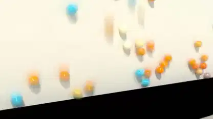

<!-- Generated by scripts/build.py. -->

# Blender에서 떨어지는 구슬이 초상화를 만드는 영상

[모음으로 돌아가기](https://github.com/VibeClip/awesome-fable-5-2-videos/blob/main/README.ko.md)

**[▶ 전체 영상](https://video.twimg.com/amplify_video/2120051188712476672/vid/avc1/1920x1080/kEwkBi941l86-UIF.mp4?tag=29)** · [원본 게시물](https://x.com/Suzacque/status/2120054690029466026)

[Suzacque](https://x.com/Suzacque) · 0:10 · 2026-11-10

제작자는 프로필 이미지를 제공하고 Fable 5.2에 설계와 Python 스크립트 작성을 맡겼습니다. Blender의 Bullet로 구슬의 낙하를 계산하고 Cycles로 렌더링했습니다. 카메라가 멀어지면 구슬로 된 초상화가 드러납니다.

## 공개 프롬프트

창작자가 공유한 원문입니다. 맥락과 필요한 입력 자료는 원본을 참고하세요.

> 3Dの物理で、能力を出し切って何か作って

[창작자의 공개 프롬프트 보기](https://x.com/Suzacque/status/2120054690029466026)

출처 및 확인 정보

- 모델 표기의 근거: 원본 게시물에 모델명 명시
- 게시물 접근 확인 날짜: 2026-11-15 — 게시물 접근 가능

게시물 접근 확인과 영상 생성 재현은 별개입니다. 생성 및 렌더링 과정은 독립적으로 재현하지 않았습니다.

[라이선스 및 미디어 권리](https://github.com/VibeClip/awesome-fable-5-2-videos/blob/main/docs/MEDIA-RIGHTS.md)

