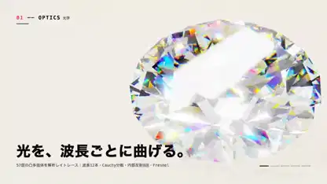

<!-- Generated by scripts/build.py. -->

# 〈빛과 파동〉 굴절에서 간섭까지

[모음으로 돌아가기](https://github.com/VibeClip/awesome-fable-5-2-videos/blob/main/README.ko.md)

**[▶ 전체 영상](https://video.twimg.com/amplify_video/2120292139250962433/vid/avc1/1280x720/4Eq6Y8beUzyI6wnM.mp4?tag=14)** · [원본 게시물](https://x.com/taka_claudecode/status/2120292244737683687)

[taka_claudecode](https://x.com/taka_claudecode) · 0:38 · 2026-11-10

제작자는 Fable 5.2가 영상과 음악을 만들었다고 밝혔습니다. 보석의 분산, 점균류를 닮은 경로, 파동처럼 움직이는 입자가 등장합니다.

## 공개 프롬프트

등록된 공개 프롬프트가 없습니다.

출처 및 확인 정보

- 모델 표기의 근거: 원본 게시물에 모델명 명시
- 게시물 접근 확인 날짜: 2026-11-14 — 게시물 접근 가능

게시물 접근 확인과 영상 생성 재현은 별개입니다. 생성 및 렌더링 과정은 독립적으로 재현하지 않았습니다.

[라이선스 및 미디어 권리](https://github.com/VibeClip/awesome-fable-5-2-videos/blob/main/docs/MEDIA-RIGHTS.md)

