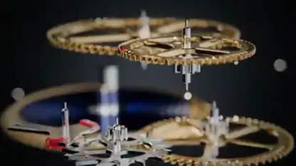

<!-- Generated by scripts/build.py. -->

# 기계식 시계 무브먼트의 분해 애니메이션

[모음으로 돌아가기](https://github.com/VibeClip/awesome-fable-5-2-videos/blob/main/README.ko.md)

**[▶ 전체 영상](https://video.twimg.com/amplify_video/2119911154638376960/vid/avc1/1920x1080/W-EtG3d_QCeqJjGK.mp4?tag=29)** · [원본 게시물](https://x.com/techfren/status/2119911343633682916)

[techfren](https://x.com/techfren) · 0:42 · 2026-11-09

제작자는 Fable 5.2가 무브먼트를 코드로 만들었다고 밝혔습니다. 톱니바퀴와 플레이트가 층층이 분리된 뒤 조립된 시계가 다시 등장합니다. 렌더링 도구는 명시되지 않았습니다.

## 공개 프롬프트

등록된 공개 프롬프트가 없습니다.

출처 및 확인 정보

- 모델 표기의 근거: 원본 게시물에 모델명 명시
- 게시물 접근 확인 날짜: 2026-11-14 — 게시물 접근 가능

게시물 접근 확인과 영상 생성 재현은 별개입니다. 생성 및 렌더링 과정은 독립적으로 재현하지 않았습니다.

[라이선스 및 미디어 권리](https://github.com/VibeClip/awesome-fable-5-2-videos/blob/main/docs/MEDIA-RIGHTS.md)

