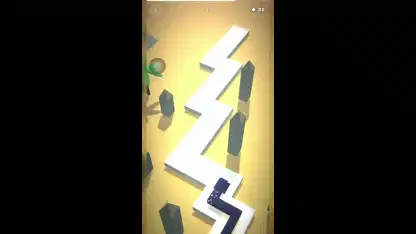

<!-- Generated by scripts/build.py. -->

# 지그재그 길을 따라가는 리듬 게임 Hibiki Trail

[모음으로 돌아가기](https://github.com/VibeClip/awesome-fable-5-2-videos/blob/main/README.ko.md)

**[▶ 전체 영상](https://video.twimg.com/amplify_video/2121223724628406273/vid/avc1/1080x1920/t3Zo4quBpWwRSnxb.mp4?tag=29)** · [원본 게시물](https://x.com/tetumemo/status/2121223780718792936)

[tetumemo](https://x.com/tetumemo) · 0:40 · 2026-11-13

제작자는 Fable 5.2로 게임 에셋과 음악을 만들고 Muse로 시연 영상을 줄였다고 밝혔습니다.

[원본 게시물](https://x.com/tetumemo/status/2121223784753713165)

## 공개 프롬프트

등록된 공개 프롬프트가 없습니다.

출처 및 확인 정보

- 모델 표기의 근거: 원본 게시물에 모델명 명시
- 게시물 접근 확인 날짜: 2026-11-14 — 게시물 접근 가능

게시물 접근 확인과 영상 생성 재현은 별개입니다. 생성 및 렌더링 과정은 독립적으로 재현하지 않았습니다.

[라이선스 및 미디어 권리](https://github.com/VibeClip/awesome-fable-5-2-videos/blob/main/docs/MEDIA-RIGHTS.md)

