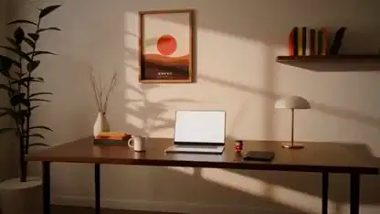

<!-- Generated by scripts/build.py. -->

# 〈새벽까지〉 Blender로 그린 책상 위 이야기

[모음으로 돌아가기](https://github.com/VibeClip/awesome-fable-5-2-videos/blob/main/README.ko.md)

**[▶ 전체 영상](https://video.twimg.com/amplify_video/2120640502261575680/vid/avc1/1280x720/k2KorEXRvxHQV80s.mp4?tag=29)** · [원본 게시물](https://x.com/toumorocorn_00/status/2120640549543936475)

[toumorocorn_00](https://x.com/toumorocorn_00) · 0:59 · 2026-11-11

제작자는 〈The Edge〉에서 영감을 받아 자체 마스코트와 음악을 담은 새 단편을 만들었습니다. Fable 5.2가 Blender 스크립트로 방, 책상, 인형을 만들었으며 음악에는 muse와 Suno를 사용했습니다.

## 공개 프롬프트

등록된 공개 프롬프트가 없습니다.

출처 및 확인 정보

- 모델 표기의 근거: 원본 게시물에 모델명 명시
- 게시물 접근 확인 날짜: 2026-11-14 — 게시물 접근 가능

게시물 접근 확인과 영상 생성 재현은 별개입니다. 생성 및 렌더링 과정은 독립적으로 재현하지 않았습니다.

[라이선스 및 미디어 권리](https://github.com/VibeClip/awesome-fable-5-2-videos/blob/main/docs/MEDIA-RIGHTS.md)

