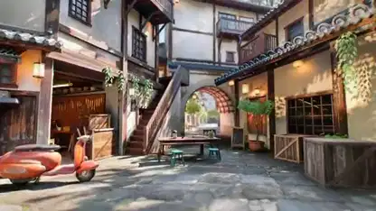

<!-- Generated by scripts/build.py. -->

# Three.js로 둘러보는 삽화풍 실내 세 곳

[모음으로 돌아가기](https://github.com/VibeClip/awesome-fable-5-2-videos/blob/main/README.ko.md)

**[▶ 전체 영상](https://video.twimg.com/amplify_video/2120947168924364800/vid/avc1/1920x1080/zq1_KKLKIQD1OmZX.mp4?tag=29)** · [원본 게시물](https://x.com/XRarchitect/status/2120947265007440052)

[XRarchitect](https://x.com/XRarchitect) · 0:21 · 2026-11-12

제작자는 Atlas, Fable 5.2, Three.js를 사용했습니다. 카메라가 밝은 안뜰에서 따뜻한 조명의 실내까지 여러 공간을 지나갑니다.

## 공개 프롬프트

등록된 공개 프롬프트가 없습니다.

출처 및 확인 정보

- 모델 표기의 근거: 원본 게시물에 모델명 명시
- 게시물 접근 확인 날짜: 2026-11-14 — 게시물 접근 가능

게시물 접근 확인과 영상 생성 재현은 별개입니다. 생성 및 렌더링 과정은 독립적으로 재현하지 않았습니다.

[라이선스 및 미디어 권리](https://github.com/VibeClip/awesome-fable-5-2-videos/blob/main/docs/MEDIA-RIGHTS.md)

