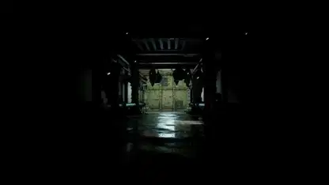

<!-- Generated by scripts/build.py. -->

# 提灯蜘蛛

[返回合集](https://github.com/VibeClip/awesome-fable-5-2-videos/blob/main/README.zh-CN.md)

**[▶ 完整视频](https://video.twimg.com/amplify_video/2122065027339329536/vid/avc1/2580x1080/TXi8bpetSDYDKLzz.mp4?tag=29)** · [原始发布](https://x.com/aGim_asf/status/2122065184743153882)

[aGim_asf](https://x.com/aGim_asf) · 1:03 · 2026-11-15

作者用 GPT 图像和 Tripo 准备素材，由 Fable 5.2 编写 Blender 的骨骼、分镜与动画脚本。原帖回复链接了完整流程、提示词和音效署名。

[原始发布](https://x.com/aGim_asf/status/2122065188325122269)

## 公开提示词

作者在下方链接分享了提示词，请结合原始上下文、参考素材和后续指令阅读。

[查看作者公开提示词](https://x.com/aGim_asf/status/2122065188325122269)

来源与核验信息

- 模型归属依据: 原帖明确提及该模型
- 原帖可访问性检查日期: 2026-11-16 — 原帖可访问

原帖可访问性检查不等于复现视频生成过程；生成与渲染未独立复现。

[许可证与媒体权利](https://github.com/VibeClip/awesome-fable-5-2-videos/blob/main/docs/MEDIA-RIGHTS.md)

