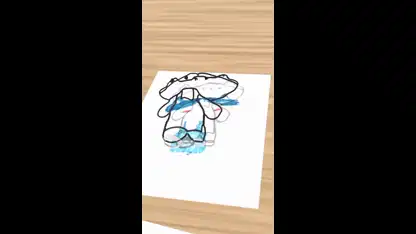

<!-- Generated by scripts/build.py. -->

# 手绘线条化作毛线，重新织出角色

[返回合集](https://github.com/VibeClip/awesome-fable-5-2-videos/blob/main/README.zh-CN.md)

**[▶ 完整视频](https://video.twimg.com/amplify_video/2121888732135788544/vid/avc1/1080x1920/T6MRHBPf7hXe_aPh.mp4?tag=29)** · [原始发布](https://x.com/akiyoshisan/status/2121890007237722501)

[akiyoshisan](https://x.com/akiyoshisan) · 1:08 · 2026-11-15

作者披露用 Fable 5.2 调用 OpenCV 从手绘原画提取线条，再通过 Python 驱动 Blender 渲染。音乐以作者的贝斯录音为素材，其中一部分由 Suno 延展。

## 公开提示词

保留作者分享时的原始语言。使用时请查看原帖上下文及所需素材。

> 手描きの線そのものを立体にして

[查看作者公开提示词](https://x.com/akiyoshisan/status/2121890007237722501)

来源与核验信息

- 模型归属依据: 原帖明确提及该模型
- 原帖可访问性检查日期: 2026-11-15 — 原帖可访问

原帖可访问性检查不等于复现视频生成过程；生成与渲染未独立复现。

[许可证与媒体权利](https://github.com/VibeClip/awesome-fable-5-2-videos/blob/main/docs/MEDIA-RIGHTS.md)

