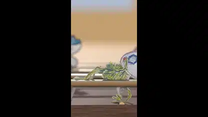

<!-- Generated by scripts/build.py. -->

# 穿越贝斯琴弦

[返回合集](https://github.com/VibeClip/awesome-fable-5-2-videos/blob/main/README.zh-CN.md)

**[▶ 完整视频](https://video.twimg.com/amplify_video/2122177261424222209/vid/avc1/1080x1920/F6rTkgB40WfGH_Kr.mp4?tag=29)** · [原始发布](https://x.com/akiyoshisan/status/2122177989928763667)

[akiyoshisan](https://x.com/akiyoshisan) · 1:07 · 2026-11-16

Fable 负责统筹，OpenCV 拆分原画，Python 驱动骨骼，Blender 渲染画面。Suno 延长了作者录制的贝斯片段。

## 公开提示词

保留作者分享时的原始语言。使用时请查看原帖上下文及所需素材。

> お絵描きに芝居をさせて

[查看作者公开提示词](https://x.com/akiyoshisan/status/2122177989928763667)

来源与核验信息

- 模型归属依据: 原帖明确提及该模型
- 原帖可访问性检查日期: 2026-11-16 — 原帖可访问

原帖可访问性检查不等于复现视频生成过程；生成与渲染未独立复现。

[许可证与媒体权利](https://github.com/VibeClip/awesome-fable-5-2-videos/blob/main/docs/MEDIA-RIGHTS.md)

