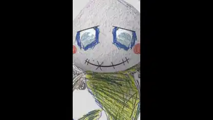

<!-- Generated by scripts/build.py. -->

# 缝起来的嘴

[返回合集](https://github.com/VibeClip/awesome-fable-5-2-videos/blob/main/README.zh-CN.md)

**[▶ 完整视频](https://video.twimg.com/amplify_video/2122969942878564352/vid/avc1/320x568/6ePWZHP5RN8fjeCS.mp4?tag=29)** · [原始发布](https://x.com/akiyoshisan/status/2122970728492646854)

[akiyoshisan](https://x.com/akiyoshisan) · 0:42 · 2026-11-18

Fable 5.2 用 Python 和 Blender 为原画制作动画。Suno 延展了作者的贝斯录音。

## 公开提示词

保留作者分享时的原始语言。使用时请查看原帖上下文及所需素材。

> 顔に芝居をさせて！

[查看作者公开提示词](https://x.com/akiyoshisan/status/2122970728492646854)

来源与核验信息

- 模型归属依据: 原帖明确提及该模型
- 原帖可访问性检查日期: 2026-11-21 — 原帖可访问

原帖可访问性检查不等于复现视频生成过程；生成与渲染未独立复现。

[许可证与媒体权利](https://github.com/VibeClip/awesome-fable-5-2-videos/blob/main/docs/MEDIA-RIGHTS.md)

