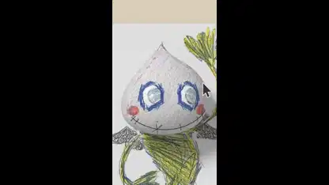

<!-- Generated by scripts/build.py. -->

# 鼠标指针被咬了一口

[返回合集](https://github.com/VibeClip/awesome-fable-5-2-videos/blob/main/README.zh-CN.md)

**[▶ 完整视频](https://video.twimg.com/amplify_video/2123710302386814976/vid/avc1/320x568/hElUVF47HZ87yHTf.mp4?tag=29)** · [原始发布](https://x.com/akiyoshisan/status/2123710585963692068)

[akiyoshisan](https://x.com/akiyoshisan) · 0:32 · 2026-11-20

Fable 5.2 编排九幅原画，用 Python 驱动 Blender，并用 FFmpeg 合成。音乐由 Suno 延展作者自己的贝斯录音。

## 公开提示词

保留作者分享时的原始语言。使用时请查看原帖上下文及所需素材。

> 絵が矢印に反応する

[查看作者公开提示词](https://x.com/akiyoshisan/status/2123710585963692068)

来源与核验信息

- 模型归属依据: 原帖明确提及该模型
- 原帖可访问性检查日期: 2026-11-21 — 原帖可访问

原帖可访问性检查不等于复现视频生成过程；生成与渲染未独立复现。

[许可证与媒体权利](https://github.com/VibeClip/awesome-fable-5-2-videos/blob/main/docs/MEDIA-RIGHTS.md)

