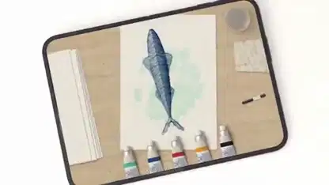

<!-- Generated by scripts/build.py. -->

# 折叠屏水彩应用演示

[返回合集](https://github.com/VibeClip/awesome-fable-5-2-videos/blob/main/README.zh-CN.md)

**[▶ 完整视频](https://video.twimg.com/amplify_video/2120301806248984576/vid/avc1/960x540/SPRHR2g2Wawm3bva.mp4?tag=29)** · [原始发布](https://x.com/anshuc/status/2120301850532499927)

[anshuc](https://x.com/anshuc) · 1:07 · 2026-11-10

作者让 Fable 5.2 设计并录制一款使用折叠角度交互的应用，提供应用设计与视频技能，并在后续进行了人工调整。

[原始发布](https://x.com/anshuc/status/2120301853825024054)

## 公开提示词

作者在下方链接分享了提示词，请结合原始上下文、参考素材和后续指令阅读。

[查看作者公开提示词](https://x.com/anshuc/status/2120301853825024054)

来源与核验信息

- 模型归属依据: 原帖明确提及该模型
- 原帖可访问性检查日期: 2026-11-16 — 原帖可访问

原帖可访问性检查不等于复现视频生成过程；生成与渲染未独立复现。

[许可证与媒体权利](https://github.com/VibeClip/awesome-fable-5-2-videos/blob/main/docs/MEDIA-RIGHTS.md)

