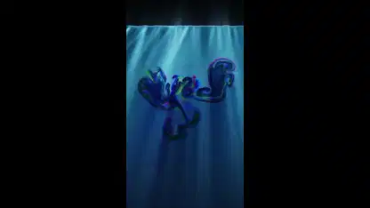

<!-- Generated by scripts/build.py. -->

# 用油滴入水的效果讲故事

[返回合集](https://github.com/VibeClip/awesome-fable-5-2-videos/blob/main/README.zh-CN.md)

**[▶ 完整视频](https://video.twimg.com/amplify_video/2120214452507115520/vid/avc1/1080x1920/C_n2LMgpQ5ZWqwdh.mp4?tag=29)** · [原始发布](https://x.com/aollivier82/status/2120324378521116962)

[aollivier82](https://x.com/aollivier82) · 0:32 · 2026-11-11

作者让 Fable 5.2 用油滴入水的效果讲一个故事。竖屏短片以光色变化连接各个场景。作者未披露渲染流程。

## 公开提示词

暂未记录公开提示词。

来源与核验信息

- 模型归属依据: 原帖明确提及该模型
- 原帖可访问性检查日期: 2026-11-14 — 原帖可访问

原帖可访问性检查不等于复现视频生成过程；生成与渲染未独立复现。

[许可证与媒体权利](https://github.com/VibeClip/awesome-fable-5-2-videos/blob/main/docs/MEDIA-RIGHTS.md)

