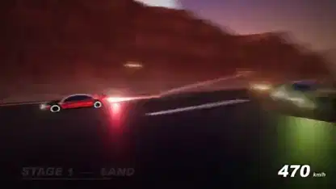

<!-- Generated by scripts/build.py. -->

# 配着 ElevenLabs 音乐的超跑特技短片

[返回合集](https://github.com/VibeClip/awesome-fable-5-2-videos/blob/main/README.zh-CN.md)

**[▶ 完整视频](https://video.twimg.com/amplify_video/2120135695037837313/vid/avc1/1920x1080/yXrA_ezGd_Frjbvw.mp4?tag=29)** · [原始发布](https://x.com/challenger_ND/status/2120149476057006186)

[challenger_ND](https://x.com/challenger_ND) · 0:30 · 2026-11-10

作者让 Fable 5.2 用代码制作赛车短片，按 ElevenLabs 音乐配合节奏。赛车在多个环境里翻转和漂移，剪辑采用游戏风格。

## 公开提示词

暂未记录公开提示词。

来源与核验信息

- 模型归属依据: 原帖明确提及该模型
- 原帖可访问性检查日期: 2026-11-15 — 原帖可访问

原帖可访问性检查不等于复现视频生成过程；生成与渲染未独立复现。

[许可证与媒体权利](https://github.com/VibeClip/awesome-fable-5-2-videos/blob/main/docs/MEDIA-RIGHTS.md)

