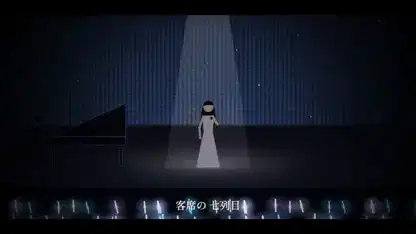

<!-- Generated by scripts/build.py. -->

# 最后一场演出

[返回合集](https://github.com/VibeClip/awesome-fable-5-2-videos/blob/main/README.zh-CN.md)

**[▶ 完整视频](https://video.twimg.com/amplify_video/2120422211702177792/vid/avc1/1280x720/s1sR2PVkGpwyUSqy.mp4?tag=29)** · [原始发布](https://x.com/challenger_ND/status/2120423740756664820)

[challenger_ND](https://x.com/challenger_ND) · 3:02 · 2026-11-11

这里展示原帖的第二版。Fable 5.2 先用代码制作初版，作者再用 Suno 制作歌曲，并按音乐调整画面。

## 公开提示词

保留作者分享时的原始语言。使用时请查看原帖上下文及所需素材。

> 全米が泣けるレベルのライブ動画をコードのみで作って

[查看作者公开提示词](https://x.com/challenger_ND/status/2120423740756664820)

来源与核验信息

- 模型归属依据: 原帖明确提及该模型
- 原帖可访问性检查日期: 2026-11-16 — 原帖可访问

原帖可访问性检查不等于复现视频生成过程；生成与渲染未独立复现。

[许可证与媒体权利](https://github.com/VibeClip/awesome-fable-5-2-videos/blob/main/docs/MEDIA-RIGHTS.md)

