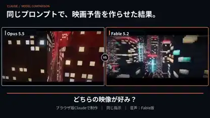

<!-- Generated by scripts/build.py. -->

# 两款模型剪出科幻预告《最终电波》

[返回合集](https://github.com/VibeClip/awesome-fable-5-2-videos/blob/main/README.zh-CN.md)

**[▶ 完整视频](https://video.twimg.com/amplify_video/2120707203707621378/vid/avc1/1920x1080/phHDECzgrrQ5213D.mp4?tag=29)** · [原始发布](https://x.com/_creatorzz_/status/2120707230513377714)

[_creatorzz_](https://x.com/_creatorzz_) · 0:20 · 2026-11-12

作者标明左侧为 Opus 5.5，右侧为 Fable 5.2。同一提示词生成的画面可对照场面调度、运镜和霓虹环境。完整提示词见作者回复。

## 公开提示词

作者在下方链接分享了提示词，请结合原始上下文、参考素材和后续指令阅读。

[查看作者公开提示词](https://x.com/_creatorzz_/status/2120707232824492180)

来源与核验信息

- 模型归属依据: 原帖明确提及该模型
- 原帖可访问性检查日期: 2026-11-15 — 原帖可访问

原帖可访问性检查不等于复现视频生成过程；生成与渲染未独立复现。

[许可证与媒体权利](https://github.com/VibeClip/awesome-fable-5-2-videos/blob/main/docs/MEDIA-RIGHTS.md)

