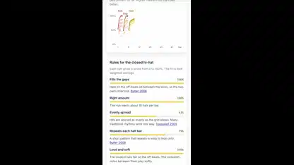

<!-- Generated by scripts/build.py. -->

# 用生成节奏片段编排的 House 舞曲

[返回合集](https://github.com/VibeClip/awesome-fable-5-2-videos/blob/main/README.zh-CN.md)

**[▶ 完整视频](https://video.twimg.com/amplify_video/2120904570314305536/vid/avc1/1206x2266/8g60h4oMlWzSL0mh.mp4?tag=29)** · [原始发布](https://x.com/deedydas/status/2120905625852936318)

[deedydas](https://x.com/deedydas) · 5:51 · 2026-11-12

作者称 Fable 5.2 为各乐器尝试不同片段，然后将选中的片段编排成 House 舞曲。原视频包含音乐和编排界面。

[原始发布](https://x.com/deedydas/status/2120905629459992996)

## 公开提示词

暂未记录公开提示词。

来源与核验信息

- 模型归属依据: 原帖明确提及该模型
- 原帖可访问性检查日期: 2026-11-15 — 原帖可访问

原帖可访问性检查不等于复现视频生成过程；生成与渲染未独立复现。

[许可证与媒体权利](https://github.com/VibeClip/awesome-fable-5-2-videos/blob/main/docs/MEDIA-RIGHTS.md)

