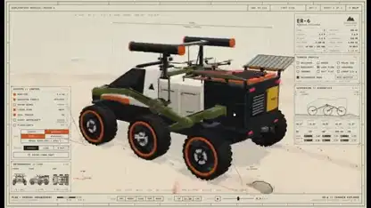

<!-- Generated by scripts/build.py. -->

# 火星车式悬架的崎岖地形模拟器

[返回合集](https://github.com/VibeClip/awesome-fable-5-2-videos/blob/main/README.zh-CN.md)

**[▶ 完整视频](https://video.twimg.com/amplify_video/2120558575387131905/vid/avc1/3456x1990/D5saQ1Xn1-2_bXLA.mp4?tag=29)** · [原始发布](https://x.com/DilumSanjaya/status/2120561077385867663)

[DilumSanjaya](https://x.com/DilumSanjaya) · 1:22 · 2026-11-11

作者让 Fable 5.2 设计摇臂转向架式车辆并模拟崎岖地形行驶。视频从多个角度展示车轮与悬架联动，原帖附有可交互版本。

## 公开提示词

暂未记录公开提示词。

来源与核验信息

- 模型归属依据: 原帖明确提及该模型
- 原帖可访问性检查日期: 2026-11-14 — 原帖可访问

原帖可访问性检查不等于复现视频生成过程；生成与渲染未独立复现。

[许可证与媒体权利](https://github.com/VibeClip/awesome-fable-5-2-videos/blob/main/docs/MEDIA-RIGHTS.md)

