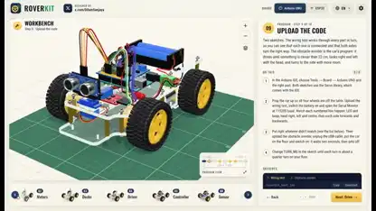

<!-- Generated by scripts/build.py. -->

# 《RoverKit》交互式机器人搭建演示

[返回合集](https://github.com/VibeClip/awesome-fable-5-2-videos/blob/main/README.zh-CN.md)

**[▶ 完整视频](https://video.twimg.com/amplify_video/2121283445456588800/vid/avc1/3456x1990/uBZhtusJ-gGu4i86.mp4?tag=29)** · [原始发布](https://x.com/DilumSanjaya/status/2121286147393651085)

[DilumSanjaya](https://x.com/DilumSanjaya) · 1:46 · 2026-11-13

作者将应用归于 Fable 5.2。演示从 3D 搭建指南切换到可视化代码说明，再到可配置场地的驾驶模拟。

[原始发布](https://x.com/DilumSanjaya/status/2121286149910220854)

## 公开提示词

暂未记录公开提示词。

来源与核验信息

- 模型归属依据: 原帖明确提及该模型
- 原帖可访问性检查日期: 2026-11-14 — 原帖可访问

原帖可访问性检查不等于复现视频生成过程；生成与渲染未独立复现。

[许可证与媒体权利](https://github.com/VibeClip/awesome-fable-5-2-videos/blob/main/docs/MEDIA-RIGHTS.md)

