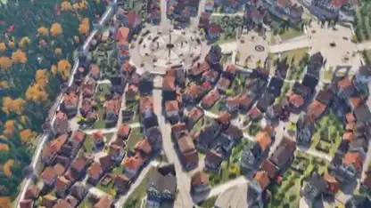

<!-- Generated by scripts/build.py. -->

# 从屋顶俯瞰到街面漫游的 3D 小镇

[返回合集](https://github.com/VibeClip/awesome-fable-5-2-videos/blob/main/README.zh-CN.md)

**[▶ 完整视频](https://video.twimg.com/amplify_video/2120059143515987968/vid/avc1/2560x1440/T0fkZZHKry2zwcnM.mp4?tag=29)** · [原始发布](https://x.com/eluchocha/status/2120059951485698350)

[eluchocha](https://x.com/eluchocha) · 0:59 · 2026-11-10

作者将小镇归于 Fable 5.2，并称素材用 Blender 制作。视频从屋顶上方俯瞰，最终落到街面。

## 公开提示词

暂未记录公开提示词。

来源与核验信息

- 模型归属依据: 原帖明确提及该模型
- 原帖可访问性检查日期: 2026-11-14 — 原帖可访问

原帖可访问性检查不等于复现视频生成过程；生成与渲染未独立复现。

[许可证与媒体权利](https://github.com/VibeClip/awesome-fable-5-2-videos/blob/main/docs/MEDIA-RIGHTS.md)

