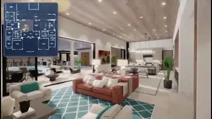

<!-- Generated by scripts/build.py. -->

# 从平面户型图到精装住宅漫游

[返回合集](https://github.com/VibeClip/awesome-fable-5-2-videos/blob/main/README.zh-CN.md)

**[▶ 完整视频](https://video.twimg.com/amplify_video/2120175906501345281/vid/avc1/1902x1080/bf_XglfsEta4QCXA.mp4?tag=16)** · [原始发布](https://x.com/everestchris6/status/2120175941616128277)

[everestchris6](https://x.com/everestchris6) · 0:10 · 2026-11-10

作者展示用 Fable 5.2 把平面图转为 3D 漫游。镜头穿过有家具的房间时，画面角落保留了平面图作为对照。

## 公开提示词

暂未记录公开提示词。

来源与核验信息

- 模型归属依据: 原帖明确提及该模型
- 原帖可访问性检查日期: 2026-11-15 — 原帖可访问

原帖可访问性检查不等于复现视频生成过程；生成与渲染未独立复现。

[许可证与媒体权利](https://github.com/VibeClip/awesome-fable-5-2-videos/blob/main/docs/MEDIA-RIGHTS.md)

