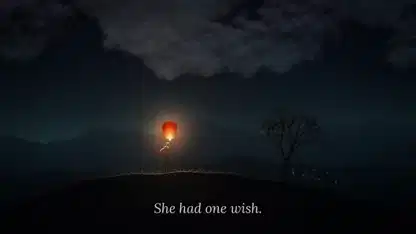

<!-- Generated by scripts/build.py. -->

# 夜色中的愿望

[返回合集](https://github.com/VibeClip/awesome-fable-5-2-videos/blob/main/README.zh-CN.md)

**[▶ 完整视频](https://video.twimg.com/amplify_video/2121360344727609344/vid/avc1/1280x720/4oNmqpcE1pO7yUPp.mp4?tag=14)** · [原始发布](https://x.com/GabransKristers/status/2121361595313828070)

[GabransKristers](https://x.com/GabransKristers) · 0:20 · 2026-11-13

作者说明，故事、代码绘制的画面与声音均由 Fable 5.2 制作。

## 公开提示词

暂未记录公开提示词。

来源与核验信息

- 模型归属依据: 原帖明确提及该模型
- 原帖可访问性检查日期: 2026-11-16 — 原帖可访问

原帖可访问性检查不等于复现视频生成过程；生成与渲染未独立复现。

[许可证与媒体权利](https://github.com/VibeClip/awesome-fable-5-2-videos/blob/main/docs/MEDIA-RIGHTS.md)

