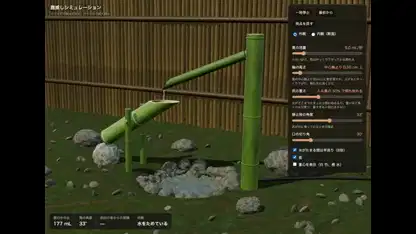

<!-- Generated by scripts/build.py. -->

# 三维添水竹筒景观

[返回合集](https://github.com/VibeClip/awesome-fable-5-2-videos/blob/main/README.zh-CN.md)

**[▶ 完整视频](https://video.twimg.com/amplify_video/2121960705310232576/vid/avc1/2400x1720/ats5frt2FrWmPy0S.mp4?tag=29)** · [原始发布](https://x.com/gengo6com/status/2121960819244372252)

[gengo6com](https://x.com/gengo6com) · 0:14 · 2026-11-15

作者说明新版添水模拟由 Fable 5.2 制作，原帖未注明渲染引擎。

## 公开提示词

暂未记录公开提示词。

来源与核验信息

- 模型归属依据: 原帖明确提及该模型
- 原帖可访问性检查日期: 2026-11-16 — 原帖可访问

原帖可访问性检查不等于复现视频生成过程；生成与渲染未独立复现。

[许可证与媒体权利](https://github.com/VibeClip/awesome-fable-5-2-videos/blob/main/docs/MEDIA-RIGHTS.md)

