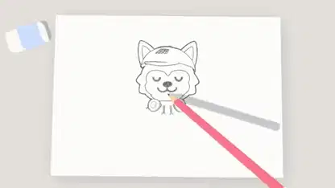

<!-- Generated by scripts/build.py. -->

# 手绘小狼跳出纸面的 3D 片头

[返回合集](https://github.com/VibeClip/awesome-fable-5-2-videos/blob/main/README.zh-CN.md)

**[▶ 完整视频](https://video.twimg.com/amplify_video/2120622616344219648/vid/avc1/1920x1080/YQkggnwdUXqipVTR.mp4?tag=16)** · [原始发布](https://x.com/husky__create/status/2120622644362199182)

[husky__create](https://x.com/husky__create) · 0:10 · 2026-11-11

作者说明片头由 Fable 5.2 制作，并使用了 Three.js。

## 公开提示词

暂未记录公开提示词。

来源与核验信息

- 模型归属依据: 原帖明确提及该模型
- 原帖可访问性检查日期: 2026-11-13 — 原帖可访问

原帖可访问性检查不等于复现视频生成过程；生成与渲染未独立复现。

[许可证与媒体权利](https://github.com/VibeClip/awesome-fable-5-2-videos/blob/main/docs/MEDIA-RIGHTS.md)

