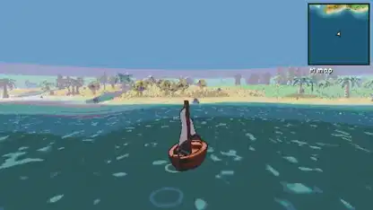

<!-- Generated by scripts/build.py. -->

# 加入战斗动作的岛屿游戏演示

[返回合集](https://github.com/VibeClip/awesome-fable-5-2-videos/blob/main/README.zh-CN.md)

**[▶ 完整视频](https://video.twimg.com/amplify_video/2120339686040158208/vid/avc1/1920x1080/-d4odGYaB3R0mUbK.mp4?tag=29)** · [原始发布](https://x.com/hyphenholdings/status/2120340122461753345)

[hyphenholdings](https://x.com/hyphenholdings) · 1:05 · 2026-11-11

作者称此轮更新由 Fable 5.2 制作闪避和连招等战斗动作。实机录像也展示从水面登岛的过程。作者在回复中附有试玩入口。

[原始发布](https://x.com/hyphenholdings/status/2120340296504643866)

## 公开提示词

暂未记录公开提示词。

来源与核验信息

- 模型归属依据: 原帖明确提及该模型
- 原帖可访问性检查日期: 2026-11-15 — 原帖可访问

原帖可访问性检查不等于复现视频生成过程；生成与渲染未独立复现。

[许可证与媒体权利](https://github.com/VibeClip/awesome-fable-5-2-videos/blob/main/docs/MEDIA-RIGHTS.md)

