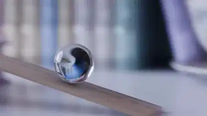

<!-- Generated by scripts/build.py. -->

# Blender 里的微缩茶室循环短片

[返回合集](https://github.com/VibeClip/awesome-fable-5-2-videos/blob/main/README.zh-CN.md)

**[▶ 完整视频](https://video.twimg.com/amplify_video/2120311299917873153/vid/avc1/1280x720/XX6AfZsYEyGyUmg8.mp4?tag=29)** · [原始发布](https://x.com/ICO_AIvideo/status/2120311646933680355)

[ICO_AIvideo](https://x.com/ICO_AIvideo) · 0:22 · 2026-11-11

作者披露用 Fable 5.2 和 Blender 制作循环短片。镜头经过瓷器和反光球，随后展现整间粉色茶室。

## 公开提示词

暂未记录公开提示词。

来源与核验信息

- 模型归属依据: 原帖明确提及该模型
- 原帖可访问性检查日期: 2026-11-15 — 原帖可访问

原帖可访问性检查不等于复现视频生成过程；生成与渲染未独立复现。

[许可证与媒体权利](https://github.com/VibeClip/awesome-fable-5-2-videos/blob/main/docs/MEDIA-RIGHTS.md)

