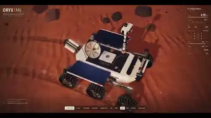

<!-- Generated by scripts/build.py. -->

# Three.js 火星车驾驶模拟

[返回合集](https://github.com/VibeClip/awesome-fable-5-2-videos/blob/main/README.zh-CN.md)

**[▶ 完整视频](https://video.twimg.com/amplify_video/2121298507961159680/vid/avc1/1280x720/nhXcrFt9DK3QepWN.mp4?tag=29)** · [原始发布](https://x.com/ikowwy/status/2121298628556013995)

[ikowwy](https://x.com/ikowwy) · 1:40 · 2026-11-13

作者说明，用 Fable 5.2 与并行代理在 Three.js 中制作可驾驶火星车，未导入 3D 模型。

## 公开提示词

暂未记录公开提示词。

来源与核验信息

- 模型归属依据: 原帖明确提及该模型
- 原帖可访问性检查日期: 2026-11-16 — 原帖可访问

原帖可访问性检查不等于复现视频生成过程；生成与渲染未独立复现。

[许可证与媒体权利](https://github.com/VibeClip/awesome-fable-5-2-videos/blob/main/docs/MEDIA-RIGHTS.md)

