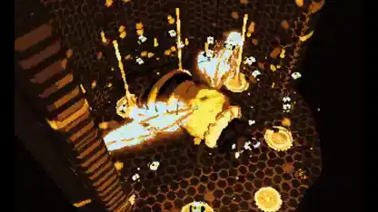

<!-- Generated by scripts/build.py. -->

# 像素风高斯泼溅：发光微缩场景

[返回合集](https://github.com/VibeClip/awesome-fable-5-2-videos/blob/main/README.zh-CN.md)

**[▶ 完整视频](https://video.twimg.com/amplify_video/2121893301498548225/vid/avc1/2684x1634/BjcN6u6IjQ3NdAI7.mp4?tag=29)** · [原始发布](https://x.com/JungleSilicon/status/2121893902286524880)

[JungleSilicon](https://x.com/JungleSilicon) · 0:38 · 2026-11-15

作者说明，这组场景用 Fable 5.2 制作，采用像素风高斯泼溅。

[原始发布](https://x.com/JungleSilicon/status/2122245541593751844)

## 公开提示词

暂未记录公开提示词。

来源与核验信息

- 模型归属依据: 原帖明确提及该模型
- 原帖可访问性检查日期: 2026-11-16 — 原帖可访问

原帖可访问性检查不等于复现视频生成过程；生成与渲染未独立复现。

[许可证与媒体权利](https://github.com/VibeClip/awesome-fable-5-2-videos/blob/main/docs/MEDIA-RIGHTS.md)

