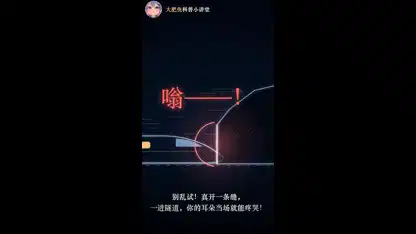

<!-- Generated by scripts/build.py. -->

# 高铁的窗户为什么是密封的

[返回合集](https://github.com/VibeClip/awesome-fable-5-2-videos/blob/main/README.zh-CN.md)

**[▶ 完整视频](https://video.twimg.com/amplify_video/2121906157061390336/vid/avc1/1080x1920/PRG5pN5e3FScxxrC.mp4?tag=29)** · [原始发布](https://x.com/karyazg/status/2121906216033272110)

[karyazg](https://x.com/karyazg) · 1:01 · 2026-11-15

作者说明这条科普视频使用了 Fable 5.2，未披露渲染流程。

## 公开提示词

暂未记录公开提示词。

来源与核验信息

- 模型归属依据: 原帖明确提及该模型
- 原帖可访问性检查日期: 2026-11-16 — 原帖可访问

原帖可访问性检查不等于复现视频生成过程；生成与渲染未独立复现。

[许可证与媒体权利](https://github.com/VibeClip/awesome-fable-5-2-videos/blob/main/docs/MEDIA-RIGHTS.md)

