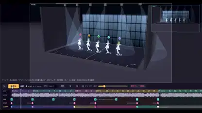

<!-- Generated by scripts/build.py. -->

# 用于角色编舞的 3D 预演舞台

[返回合集](https://github.com/VibeClip/awesome-fable-5-2-videos/blob/main/README.zh-CN.md)

**[▶ 完整视频](https://video.twimg.com/amplify_video/2120148511836835840/vid/avc1/2830x1496/qlQkuQ7RRb6l2keO.mp4?tag=29)** · [原始发布](https://x.com/keiru_ai/status/2120148813142958454)

[keiru_ai](https://x.com/keiru_ai) · 0:54 · 2026-11-10

作者说明原型使用 Fable 5.2、Claude Code 与 Suno，并支持导入 VRM 角色及 Mixamo FBX 动作。

## 公开提示词

暂未记录公开提示词。

来源与核验信息

- 模型归属依据: 原帖明确提及该模型
- 原帖可访问性检查日期: 2026-11-13 — 原帖可访问

原帖可访问性检查不等于复现视频生成过程；生成与渲染未独立复现。

[许可证与媒体权利](https://github.com/VibeClip/awesome-fable-5-2-videos/blob/main/docs/MEDIA-RIGHTS.md)

